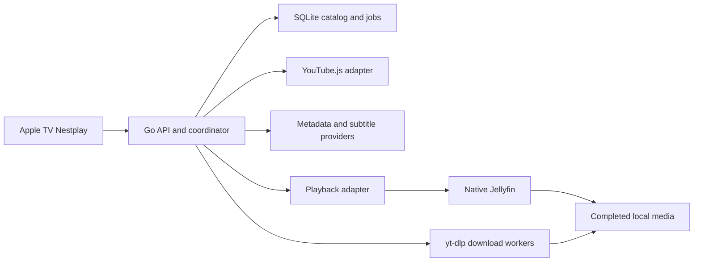

# Nestplay PoC architecture findings
<!-- Preserved project research. -->

10 September 2026. Three Wayfinder research tickets are resolved at documentation level. The architecture remains a candidate pending user connection/packaging decisions and live account/device validation. No service was installed, no user session accessed and no playback benchmark run.

Update 11 September 2026: the first independent execution milestone is complete at simulator level. The [Go-to-tvOS health-check PoC](../../README.md) and its [handoff](../../HANDOFF.md) establish the basic client/server seam. Physical Apple TV acceptance remains open; no YouTube or media capability is implied by this milestone.

## Recommended candidate

| Responsibility | Candidate | Boundary |
|---|---|---|
| API, catalog, jobs and disk policy | Go + SQLite | Nestplay owns stable media IDs and queue state |
| Personalized Home/search | YouTube.js running through Deno | Replaceable adapter with opaque pagination cursors |
| Downloads and existing captions | yt-dlp, Deno/EJS, FFmpeg | Supervised workers, published only after completion |
| Original-language movie metadata/covers | TMDB | Per-movie language and explicit identity correction |
| Spanish movie subtitles | OpenSubtitles.com | Best file/release match, any Spanish variant, quota-aware |
| Playback and temporary conversion | Native Jellyfin | Replaceable playback adapter; internal provider item mapping |
| Apple TV experience | Custom SwiftUI app and AVPlayerViewController | Native controls, track menus and automatic hiding |

This is a proposed arrangement. Exact authenticated media URL routing and HLS playlist/segment handling must be exercised on the actual Apple TV. Keep TV-facing records independent of Jellyfin's item schemas so another playback engine can be added later.

## Findings that change earlier assumptions

1. Mac sign-in is not yet a solved button. YouTube.js documents cookie authentication for web Home; its OAuth option is TV-client-specific. Cookie persistence is not automatic renewal. A locally imported session is a candidate PoC shortcut, not an accepted user decision. [YouTube research](youtube-session.md).
2. Original-language metadata requires per-item requests. TMDB's original title is distinct from its localized overview. Missing original descriptions should remain absent rather than silently becoming English. Subtitle matching prioritizes synchronization over regional Spanish, and free provider quotas may delay large imports. [Metadata research](metadata-subtitles.md).
3. On-demand conversion makes Jellyfin a stronger fit than a tiny file server alone. Go need not implement media encoding; it can supervise a mature backend through a narrow contract. [Playback research](playback-packaging.md).
4. A single entry executable/config is feasible; literally one process with every capability is not the recommended packaging. A bundle may contain Go, Deno, yt-dlp and media tools; native Jellyfin can initially be configured separately. Exact redistribution licenses remain tied to actual binaries. [Packaging evidence](playback-packaging.md).
5. A 20 GB threshold needs proactive stopping. Buffered writes and other applications can overshoot a polling threshold. Use an early-stop margin and supervise all download/transcode writers; Jellyfin's segment cleanup is not a hard byte limit. Full-file merging also temporarily needs extra space. [Storage evidence](playback-packaging.md).

## What is still open

- User acceptance of local session import versus requiring integrated browser sign-in.
- Metadata/subtitle provider access and actual account quotas.
- Representative user-selected movie files. The user confirmed Apple TV HD A1625, tvOS 26.6; test against this device, not a generic Apple TV 4K profile.
- Live personalized feed, pagination, restart and reconnect evidence.
- Subtitle selection/synchronization, direct play and conversion evidence.
- Safe simulated/isolated-volume disk-threshold tests and measured resource use.
- Final acceptance of packaging and the stack after those results.

[Validation plan](validation-plan.md) specifies the bounded proofs. The canonical [Wayfinder map](../../.scratch/nestplay/map.md) indexes resolved research and its child tickets preserve open dependencies.

## Target-device refinement

Apple TV A1625 is the HD model. The initial conservative playback profile should use 1080p SDR H.264 within Apple's listed profile/level constraints, with supported audio. Evaluate other documented formats on-device before enabling them. The accepted highest-direct-play-quality policy therefore does not imply downloading 4K YouTube sources for this TV. Existing higher-quality movies remain originals and convert only during playback where necessary. [Apple TV HD specifications](https://support.apple.com/en-us/111928).
