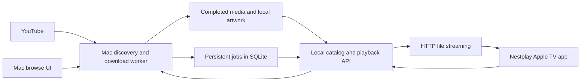

# Nestplay component research
<!-- Preserved project research. -->

Research date: 10 September 2026. This is a source and architecture review, not a deployment or performance benchmark. Perch was inspected read-only. Footprint rankings below are architectural estimates; no comparable measured Mac RAM figures were established.

I recommend a native Swift Nestplay server built around Perch's download core, yt-dlp, FFmpeg, Deno, SQLite and Hummingbird, with a custom SwiftUI Apple TV client. This is the lightest proposed product architecture and gives playlists a proper place in the library. If the priority is getting an existing open-source TV experience running sooner, use native Jellyfin with ytdl-sub and Swiftfin. MeTube can replace the download interface when a ready-made web queue matters more than the smallest installation.

## Three viable stacks

| Stack | Mac components | Apple TV | Relative footprint | Work still needed |
|---|---|---|---|---|
| A. Native Nestplay, recommended product | PerchCore + Hummingbird + SQLite; yt-dlp, Deno/EJS and FFmpeg only when needed | Custom SwiftUI client using AVPlayer, with an optional broader-codec player later | Lowest expected idle overhead. One app/service, embedded database, no Linux VM | Build discovery/search UI, durable queue, catalog, pairing, playback progress and TV app |
| B. Existing open-source library | Native Jellyfin + ytdl-sub batch jobs + a small URL/search front end | Swiftfin initially; custom Nestplay client can later use Jellyfin's API | Moderate. Jellyfin remains resident; downloader can exit between jobs | Add source browsing; configure metadata and ordered playlist-to-series mapping |
| C. Existing download web UI | MeTube + metadata importer + native Jellyfin | Swiftfin initially or custom client | Moderate natively; higher with a Linux container VM | Add full YouTube browsing if required, generate/import NFO metadata and reconcile playlists |

These are composable designs, not claims that an unconfigured combination fulfills every requirement. Stack A has the most development work. Stack B gives the best balance of mature media features and Mac resource use. Stack C gives the quickest browser-based download controls.

Stack B's native ytdl-sub route needs a qualification: upstream documents pip installation but discourages it because of possible FFmpeg conflicts. Use an isolated, validated Python environment if avoiding a VM; otherwise use its container and accept the extra footprint. Native Perch/yt-dlp plus an NFO importer is the alternative if native packaging proves brittle. The recommended ytdl-sub web-GUI image includes code-server, so it is not the smallest download frontend. [Installation guidance](https://ytdl-sub.readthedocs.io/en/latest/guides/install/agnostic.html).

For B and C, keep Jellyfin native on macOS. Its documented Mac package avoids a Linux VM, and VideoToolbox gives access to Mac media acceleration. Linux containers on a Mac add a virtualized operating system. [Mac installation](https://jellyfin.org/docs/general/installation/macos/), [Apple acceleration](https://jellyfin.org/docs/general/post-install/transcoding/hardware-acceleration/apple/), [Docker on Mac](https://docs.docker.com/desktop/troubleshoot-and-support/faqs/macfaqs/).

## Component comparison

| Component | License | Downloads, browsing and playlists | Metadata and integration | Streaming and Mac suitability |
|---|---|---|---|---|
| yt-dlp | Source mainly Unlicense; bundled distributions include other licenses | Individual videos, playlists and channels; extraction/search primitives, not a complete browser UI | CLI and Python API; structured JSON and progress; thumbnail/subtitle sidecars | Download engine, not a library server. Native Mac execution and short-lived workers fit A |
| ytdl-sub | GPL-3.0 | URL/subscription-driven downloads and playlists; no YouTube browsing UI | YAML presets, NFO files, artwork, naming and retention; CLI is the main integration boundary | No playback server. Strong filesystem bridge into Jellyfin |
| MeTube | AGPL-3.0 | Web download queue, individual videos, playlists, channels and now recurring subscriptions; not a full YouTube discovery frontend | HTTP/Socket.IO application interface, configurable yt-dlp output; add a library metadata adapter | No adaptive media server. Python service; arm64 container available, native source setup has more packaging work |
| Pinchflat | AGPL-3.0 | Channel/playlist collection and monitoring; oriented around ongoing sources | Media profiles and media-center metadata; web UI, internal routes | Elixir/Phoenix with SQLite; lighter dependency count than Tube Archivist, but development pause weakens recommendation |
| Tube Archivist | GPL-3.0 | YouTube archive, channels/playlists, downloaded-library search and playback | Rich metadata, search index and REST API | App plus Redis and Elasticsearch. Too heavy for this brief; no first-party tvOS client established |
| TubeSync | AGPL-3.0 | Scheduled channel/playlist capture, retries; less focused on one-off intake | SQLite by default, metadata/artwork and Jellyfin/Plex refresh integration | Container-oriented Python/Django service; downstream server handles Apple TV playback |
| Jellyfin | GPL-2.0 | Local-library browsing and server playlists; downloads require another component | HTTP API, generated SDKs, artwork/NFO readers, library indexing and playback state | Native Mac; direct play, remux and FFmpeg transcoding; best ready-made server here |
| Swiftfin | MPL-2.0 | Native Apple TV library client; upstream docs currently say playlists are unsupported | Consumes Jellyfin metadata; supports shows, movies, music videos and home videos | Native/VLC player architecture. Strong starting client, but requires testing with the chosen server and tvOS versions |
| Hummingbird | Apache-2.0 | Build Nestplay routes and catalog on top | Swift HTTP framework; JSON endpoints and file middleware | SwiftNIO-based, small dependency design. File middleware supports partial-content responses; no catalog/transcoder included |
| Invidious | AGPL-3.0 | Actual YouTube browsing/search, channels and playlists | Documented JSON API for search, videos and playlists | Extra frontend service, PostgreSQL and companion. Optional browsing provider, not Nestplay's downloaded-file library |

Sources for the table: [yt-dlp](https://github.com/yt-dlp/yt-dlp), [ytdl-sub](https://github.com/jmbannon/ytdl-sub), [MeTube](https://github.com/alexta69/metube), [Pinchflat](https://github.com/kieraneglin/pinchflat), [Tube Archivist](https://github.com/tubearchivist/tubearchivist), [Jellyfin](https://github.com/jellyfin/jellyfin), [Swiftfin](https://github.com/jellyfin/Swiftfin), [Swiftfin library support](https://github.com/jellyfin/Swiftfin/blob/main/Documentation/libraries.md), [Hummingbird](https://github.com/hummingbird-project/hummingbird), [Invidious](https://github.com/iv-org/invidious).

TubeSync is another option for B/C when automatic capture matters most. It is a better maintenance candidate than paused Pinchflat, though it adds another service. [TubeSync repository](https://github.com/meeb/tubesync).

For API composition, ytdl-sub is primarily CLI/files. MeTube exposes queue routes such as `POST /add` and `POST /subscribe`, but these are source-level interfaces to pin and test. Tube Archivist documents token-authenticated REST and Swagger at `/api/docs/`. Pinchflat's inspected router mainly exposes web/feed routes; a stable public REST contract was not established. [MeTube routes](https://github.com/alexta69/metube/blob/master/app/main.py), [Tube Archivist API](https://docs.tubearchivist.com/api/introduction/), [Pinchflat routes](https://github.com/kieraneglin/pinchflat/blob/master/lib/pinchflat_web/router.ex).

## Maintenance snapshot

| Project | Evidence observed | Decision |
|---|---|---|
| yt-dlp | Stable 2026.08.19 | Preferred engine; keep its update lifecycle independent from app releases |
| ytdl-sub | 2026.08.26.post1 | Current candidate for automation and library metadata |
| MeTube | Repository activity in August 2026; current README includes subscriptions | Current candidate; pin a tested revision/image rather than rely on a moving image |
| Pinchflat | Latest release v2025.9.26; open development-pause announcement | Keep as an alternative, not the default foundation |
| Tube Archivist | v0.5.12, release page displays 25 August | Maintained candidate with an unsuitable dependency footprint |
| TubeSync | v0.18.4, 4 September 2026 | Current alternative for subscription capture |
| Jellyfin | 12.0 released 8 September 2026 | Active, but newly changed API/authentication and database behavior need a client smoke test |
| Swiftfin | 1.6.1 released 23 August 2026, including tvOS fixes | Active; playlist support still cannot be assumed |
| Hummingbird | 2.26.0 released 29 July 2026 | Active Swift server foundation; current compiler requirements need checking against Perch |
| Invidious | v2.20260804.1 on 5 August 2026 | Active optional browser layer, with continuing upstream YouTube coupling |

Release/activity sources: [yt-dlp releases](https://github.com/yt-dlp/yt-dlp/releases), [ytdl-sub releases](https://github.com/jmbannon/ytdl-sub/releases), [MeTube commits](https://github.com/alexta69/metube/commits/master/), [Pinchflat pause](https://github.com/kieraneglin/pinchflat/issues/800), [Tube Archivist releases](https://github.com/tubearchivist/tubearchivist/releases), [Jellyfin releases](https://github.com/jellyfin/jellyfin/releases), [Swiftfin 1.6.1](https://github.com/jellyfin/Swiftfin/releases/tag/1.6.1), [Hummingbird releases](https://github.com/hummingbird-project/hummingbird/releases), [Invidious releases](https://github.com/iv-org/invidious/releases).

TubeSync release evidence: [v0.18.4 and release history](https://github.com/meeb/tubesync/releases). Release dates indicate observed maintenance, not a guarantee of working YouTube extraction on every account or network.

Jellyfin 12 removes legacy route prefixes and disables legacy authorization by default. Use current API authentication and test the exact TV client, especially third-party clients. That is a reason to validate a pinned combination, not to substitute an unmaintained server. [Jellyfin 12 release notes](https://github.com/jellyfin/jellyfin/releases/tag/v12.0).

## What Perch already provides

The inspected checkout's latest commit was `35ac113`, dated 9 September 2026. The source is ahead of its README's planning-only description. `Package.swift` defines a macOS 14 Swift package with separate PerchCore, PerchUI and executable targets and no external package dependencies. No root license file was found; this private project should not be described as already open source.

| Inspected file | Reusable behavior | Nestplay changes |
|---|---|---|
| `Sources/PerchCore/DownloadInvocation.swift` | Explicit tool paths, isolated yt-dlp configuration, Deno selection, destination and temporary paths, structured progress and final-file events | Add metadata sidecars, stable IDs, archive/deduplication and queue policy |
| `Sources/PerchCore/PerchCore.swift` | Video/audio modes; highest-quality selection | Add a separate TV compatibility policy |
| `Sources/PerchCore/DownloadToolEvent.swift` | Typed download/postprocess/final-artifact parsing | Feed a durable job store and client events |
| `Sources/PerchCore/ToolProcess.swift` | Argument-array process launch, concurrent output reading, task cancellation | Bound log buffering, ensure subprocess-tree cancellation and restart recovery |
| `Sources/PerchCore/PlaylistProgress.swift` | Queued, checking, downloading, processing and terminal states | Persist jobs and discover entries; this is not yet a complete queue |
| `Sources/PerchUI/PerchWindowController.swift` | Working native form, progress and cancellation | Move orchestration out of window ownership into a background service |

Evidence comes from those local files plus `docs/HANDOFF.md`, inspected in the requested Perch directory. I did not execute downloads, run tests or change Perch.

The core accepts `expandsPlaylist` and generates playlist arguments, but the window constructs the request without enabling it. There is no implemented YouTube browser, durable media catalog, HTTP streaming server or tvOS target in this package. Tool paths currently default to Homebrew locations, and the handoff explicitly says the app is not distribution-ready.

The most important correction is Perch's video command: `bv*+ba/b` followed by `--remux-video mp4`. Remuxing does not turn VP9/AV1 into H.264/HEVC or guarantee compatible audio. Preserve highest quality as an archival choice; do not label it Apple TV-compatible just because the extension is MP4.

## Recommended native architecture

This is a proposed design. Reuse PerchCore inside the Mac service. Run yt-dlp and its JavaScript runtime on demand, then let them exit. Serve completed files directly over HTTP with range support so playback and seeking do not require an encoder running continuously. Hummingbird's file middleware already contains range/partial-content handling, but seeking, suffix ranges, invalid ranges and large files still need protocol tests. [File middleware source](https://github.com/hummingbird-project/hummingbird/blob/main/Sources/Hummingbird/Middleware/FileMiddleware.swift).

Use SQLite for videos, files, jobs, channels, playlists, playlist entries and watch progress. Store video ID separately from playlist-entry identity: a video can occur in multiple lists, and lists can contain repeated entries. Keep one media file per video/quality variant while preserving every ordered membership. File names should include stable source IDs; titles alone collide. SQLite adds no database server process and its deliverable code is public domain. [SQLite licensing](https://www.sqlite.org/copyright.html).

Proposed API responsibilities are local search/catalog, YouTube discovery, job submission/status/cancellation, playlist entries, artwork, playback URLs and resume position. Bonjour can advertise the service; pair the TV once using a displayed code. A custom SwiftUI client can show landscape thumbnails, channel rows, saved playlists and continue-watching without pretending that every YouTube video is a movie.

Download into staging. After the final move event, verify the file with ffprobe and import metadata in one transaction. Never expose `.part` files in the library. Keep the original source JSON plus normalized title, channel, date, duration, description, chapters, thumbnail and caption references. Store artwork locally so an offline library screen does not contact YouTube.

Start with one download at a time and a bounded number of fragment connections. Perch currently requests ten fragment connections. That is a throughput choice, not a lightweight default. Keep log buffers bounded and release helper processes after work completes.

## Playback, quality and footprint

For the lightest stack, choose a compatible source representation where available, then direct play. If a chosen download cannot play on the target Apple TV, either prepare a compatible copy once on the Mac or use a player with broader codec support. The Apple TV model, codec profile, bit depth and audio format matter. Avoid a blanket H.264-only archival policy if highest resolution matters.

HLS is useful when adaptive bitrate or live transcoding is needed; it is not required merely to serve completed files across a LAN. Add it only after direct playback requirements are understood. [Apple HLS overview](https://developer.apple.com/streaming/).

Jellyfin already supplies the fallback path. Its Mac acceleration support uses VideoToolbox; available decoding and encoding depend on the Mac. Native deployment is the appropriate path for this feature. [Mac acceleration details](https://jellyfin.org/docs/general/post-install/transcoding/hardware-acceleration/apple/).

There is no defensible apples-to-apples RAM table from the reviewed sources. Compare resident processes instead. A has one small native service and SQLite; B adds Jellyfin's runtime/indexer; C adds a persistent web queue and, if containerized, a Linux VM. Tube Archivist adds an Elasticsearch index and Redis. Downloading, thumbnail generation, scanning and transcoding cause temporary peaks that idle RAM does not capture. Jellyfin's general recommendation of 8 GB system RAM is not an assertion that its server consumes 8 GB. [Hardware guidance](https://jellyfin.org/docs/general/administration/hardware-selection/).

Tube Archivist does publish a useful system requirement: about 2 GB available RAM for a small test setup and 4 GB for medium/large installations. These are capacity requirements, not measured idle memory. That is sufficient reason to exclude it from the lightest shortlist. [Tube Archivist requirements](https://github.com/tubearchivist/tubearchivist).

Before choosing performance budgets, measure ten minutes idle, a completed-file stream with seeking, a download during playback, library scanning and one incompatible-codec case. Record total process-tree memory, CPU/energy, disk writes and time to first frame, including VM overhead where present. No such measurements were performed for this report.

## Browsing YouTube and preserving playlists

Most candidates solve URL ingestion, not browsing all of YouTube. The smallest approach is a custom discovery UI using bounded yt-dlp searches and playlist/channel extraction, with cached results. It will not reproduce YouTube's personalized homepage. A browser/share action can remain an additional entry point, but cannot replace in-app discovery if that is part of Nestplay's product promise.

If richer browsing is essential immediately, add a locally hosted Invidious instance and use its search/video/playlist APIs. It adds PostgreSQL and a companion process to the deployment. Do not use a public instance for the default private design. Keep the downloader independent, accepting canonical YouTube IDs/URLs, so a browsing-provider outage does not break saved playback. [Invidious API](https://docs.invidious.io/api/), [installation dependencies](https://docs.invidious.io/installation/).

For Jellyfin stacks, yt-dlp JSON is not automatically Jellyfin metadata. Use ytdl-sub presets or an importer to generate NFO and local artwork. Jellyfin documents its NFO reader and supported fields. [NFO metadata](https://jellyfin.org/docs/general/server/metadata/nfo/).

Swiftfin's library documentation currently marks playlists unsupported. A practical workaround is to map each selected playlist to a show/season with numbered episodes. That is a presentation adapter; it needs explicit handling of reordering, duplicates and deleted entries. Collections alone do not promise ordered playlist playback. For true first-class playlists, build the Nestplay TV interface over the catalog or Jellyfin API. Jellyfin provides an MPL-2.0 Swift SDK generated from OpenAPI. [Library limitations](https://github.com/jellyfin/Swiftfin/blob/main/Documentation/libraries.md), [Swift SDK](https://github.com/jellyfin/jellyfin-sdk-swift).

## LAN privacy and operational boundaries

“Private on the LAN” can mean the catalog, files, accounts and playback never leave home. It cannot mean zero Internet traffic while searching or downloading from YouTube. Nestplay should require outbound access only for discovery/downloads and chosen software updates; saved playback must continue when WAN access is disabled.

Bind services to the intended local interface, use local authentication/pairing, and do not configure port forwarding, public tunnels or cloud accounts. In Jellyfin, disable external access and set local-network scope explicitly. Disable unneeded remote metadata fetchers and store downloaded artwork locally. A localhost-only listener will not be reachable from Apple TV; a listener on all interfaces is not proof of LAN-only access. [Jellyfin networking](https://jellyfin.org/docs/general/post-install/networking/).

Keep cookie access on the Mac, opt-in and out of logs. Modern YouTube extraction needs more than a frozen yt-dlp binary: package a supported JavaScript runtime and matching EJS scripts, and accommodate upstream extraction changes. Some sessions/formats also require PO-token handling. This does not guarantee access to every video. [yt-dlp EJS requirements](https://github.com/yt-dlp/yt-dlp/wiki/EJS), [PO-token guide](https://github.com/yt-dlp/yt-dlp/wiki/PO-Token-Guide).

## Licensing and excluded shortcuts

Choose and record licenses for Nestplay and any reused private Perch code before distributing them. Inspect the actual shipped helper binaries: yt-dlp's source license does not describe every bundled dependency, and FFmpeg's licensing depends on build options. FFmpeg is primarily LGPL-2.1-or-later, with GPL components available through build flags. Maintain notices and the appropriate source/build information for the selected distribution. [FFmpeg license details](https://ffmpeg.org/legal.html), [yt-dlp licensing](https://github.com/yt-dlp/yt-dlp#licensing).

In particular, yt-dlp's PyInstaller executables, including the Mac bundle, contain GPLv3+ code; do not ship them with only an Unlicense notice. Deno is a separate runtime dependency even when the executable bundles the EJS scripts. [Distribution details](https://github.com/yt-dlp/yt-dlp/blob/master/README.md?plain=1), [EJS packaging](https://github.com/yt-dlp/yt-dlp/wiki/EJS).

Keeping third-party services separate behind documented interfaces makes upgrades and replacements easier. It is not a blanket exemption from GPL, AGPL or MPL obligations. In particular, preserve component licenses when modifying or distributing them; source-visible is not synonymous with permissively licensed.

Infuse plus a Mac SMB share is a useful low-server-overhead comparison, but Infuse is a proprietary client and does not satisfy a fully open-source stack. SMB alone also does not supply a YouTube catalog or download workflow. [Infuse network-share support](https://support.firecore.com/hc/en-us/articles/215090977-Streaming-From-a-Mac-PC-or-NAS).

I would begin Nestplay's implementation with stack A if the custom Apple TV experience is the actual product goal. If the immediate goal is to watch a growing archive with minimal new application work, choose B, validate the show/episode representation of playlists, and keep files and metadata portable so the custom client can follow.
